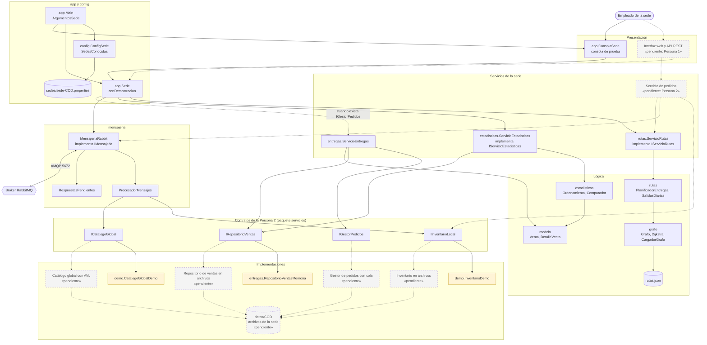
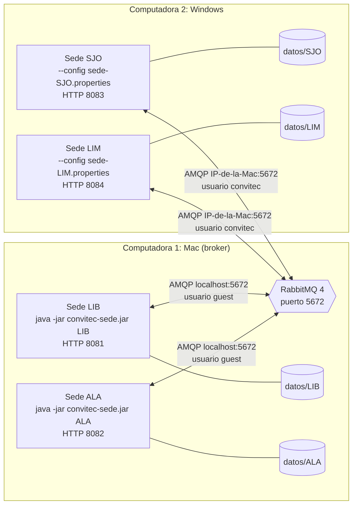
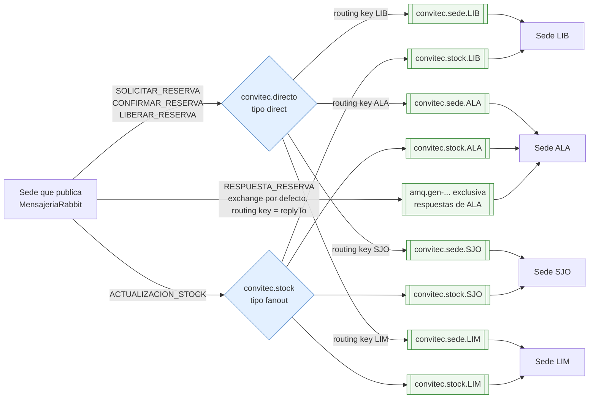
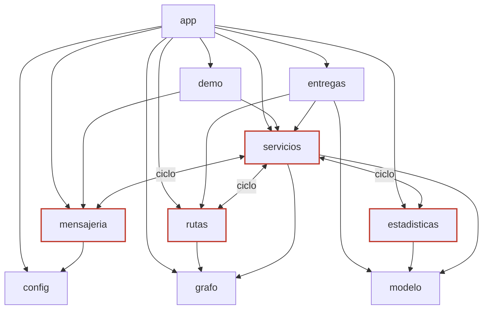

# Arquitectura

Parte del [DI3 — Diseño de la solución](DI3-diseno-solucion.md).

Convenciones de los diagramas:
- **Línea punteada** o etiqueta **«pendiente»**: componente de la Persona 1 o de la Persona 2 que todavía no existe. Se dibuja con el nombre de la interfaz que debe implementar.
- Fondo amarillo: clases de **demostración** (paquete `demo`), provisionales hasta que la Persona 2 las reemplace.
- Los nombres de paquetes, clases, exchanges y colas son los del código (`src/main/java/cr/ac/tec/convitec`).

## a) Componentes de una sede

Cada sede (LIB, ALA, SJO o LIM) es un proceso Java independiente con todos estos componentes. `app.Sede` los crea a partir de su `ConfigSede` y los conecta.

Notas:
- `ServicioEntregas` ya está implementado y probado, pero `Sede` todavía no lo crea porque necesita un `IGestorPedidos`, que es de la Persona 2.
- Hoy la sede arranca con las clases de `demo`. La Persona 2 cambia las 3 líneas marcadas en `Sede.conDemostracion` por sus clases reales.

## b) Despliegue en 2 computadoras

### Computadoras y procesos

- Cada sede usa solo sus archivos (`config.getCarpetaDatos()`), y no lee los de las otras.
- Las sedes de Windows usan un `.properties` externo (`--config`) con `rabbit.host` = IP de la Mac. La clave se toma de `CONVITEC_RABBIT_CLAVE`.
- Requisitos de red en la Mac: comentar `NODE_IP_ADDRESS=127.0.0.1` en `rabbitmq-env.conf`, crear un usuario distinto de `guest` y abrir el puerto 5672. El paso a paso está en el [README](../../README.md).

### Topología de RabbitMQ

Definida en `mensajeria.TopologiaRabbit` y declarada por `MensajeriaRabbit.iniciar()`.

- Las colas `convitec.sede.COD` y `convitec.stock.COD` son **durables** (no exclusivas, sin autoDelete). Si una sede está apagada, sus mensajes la esperan.
- La cola de respuestas la crea el servidor (`queueDeclare()`). Es **exclusiva** y se borra sola cuando la sede se desconecta. Cada sede tiene la suya; en el diagrama solo se muestra la de ALA.
- La sede que publica en `convitec.stock` también recibe su propia copia en `convitec.stock.COD`, y `ProcesadorMensajes` la ignora.

## c) Paquetes y dependencias

Dependencias reales, obtenidas de los `import` de `src/main/java` (A → B significa "A usa clases de B"):

Qué muestra:
- `grafo`, `modelo` y `config` no dependen de nadie: son la base.
- `app` es el único paquete que conoce a todos, porque es el que arma la sede.
- Los módulos de cada integrante se conectan por las interfaces de `servicios`. Por ejemplo, `entregas` solo conoce `IGestorPedidos` e `IRepositorioVentas`, y `mensajeria` solo conoce `IInventarioLocal` e `ICatalogoGlobal`.

**Ciclos que existen hoy (en rojo).** Hay 3 ciclos de dos paquetes: `servicios` ↔ `rutas`, `servicios` ↔ `estadisticas` y `servicios` ↔ `mensajeria`. Aparecen porque las interfaces de `servicios` devuelven clases de resultado que viven en los paquetes que las implementan:

| Interfaz en `servicios` | Usa clases de |
|---|---|
| `IServicioRutas` | `grafo.ResultadoRuta`, `rutas.SolicitudEntrega`, `rutas.ParadaEntrega`, `rutas.RecorridoEntrega` |
| `IServicioEstadisticas` | `estadisticas.ProductoEstrella`, `estadisticas.ResumenProducto` |
| `IMensajeria`, `IInventarioLocal` | `mensajeria.RespuestaReserva` |

Estos ciclos no impiden compilar ni probar el proyecto, pero hacen que los paquetes no se puedan separar. **Mejora propuesta** (no aplicada): mover esas clases de resultado, que son inmutables y no tienen lógica, a `modelo`. Así `servicios` dependería solo de `modelo` y el grafo de paquetes quedaría sin ciclos.
