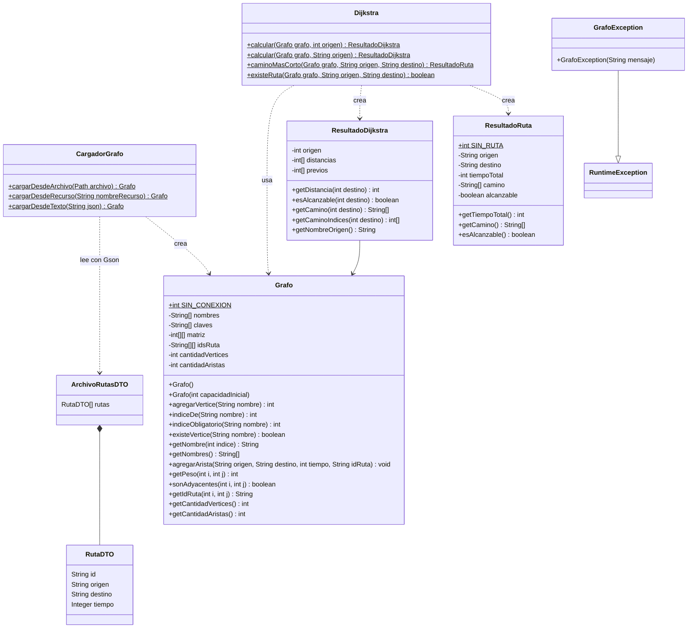
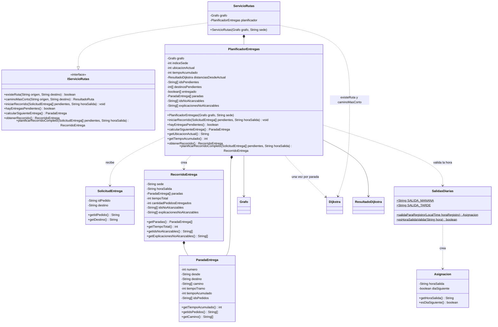
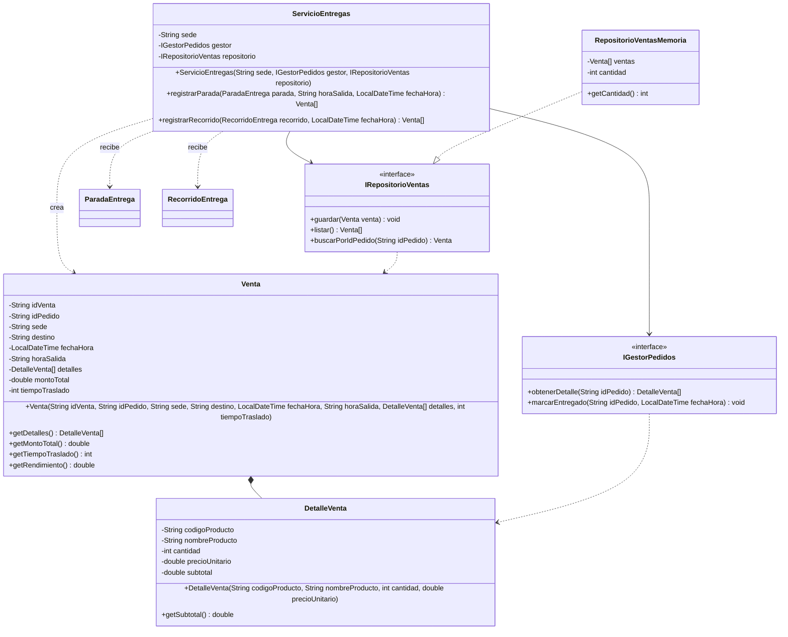
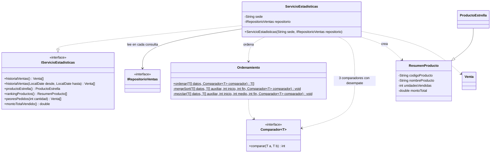
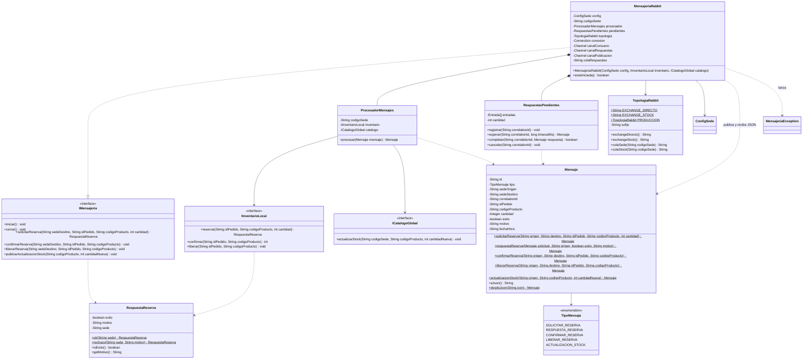
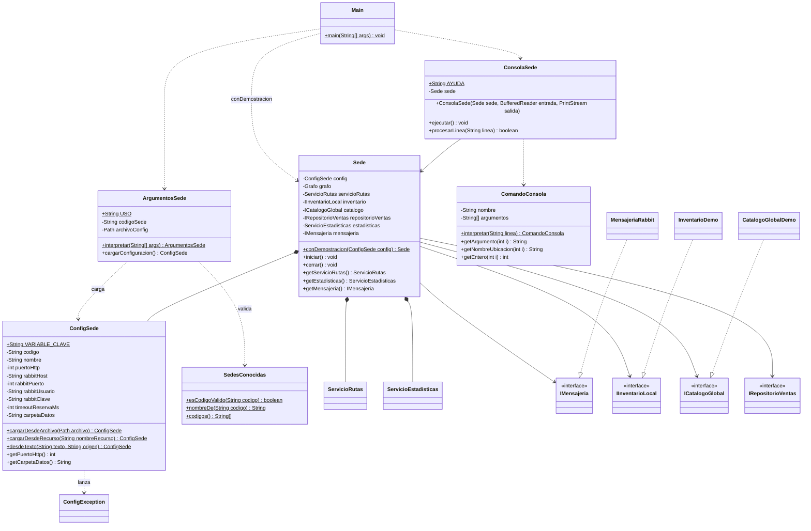

# Diagramas de clases (Persona 3)

Parte del [DI3 — Diseño de la solución](DI3-diseno-solucion.md).

Paquetes: `grafo`, `rutas`, `modelo` (ventas), `entregas`, `estadisticas`, `mensajeria`, `config` y `app`, todos dentro de `cr.ac.tec.convitec`. Se muestran los atributos y métodos públicos principales; se omiten getters triviales cuando no aportan. Las interfaces del paquete `servicios` aparecen como «interface». Las clases de otros paquetes aparecen sin miembros, solo para mostrar la relación.

Relaciones: `..|>` implementa, `*--` contiene (composición), `-->` tiene una referencia, `..>` usa o crea.

## grafo

## rutas

`Asignacion` es la clase anidada `SalidasDiarias.Asignacion`.

## modelo (ventas) y entregas

`IGestorPedidos` e `IRepositorioVentas` (paquete `servicios`) los implementa la Persona 2. Por ahora, `RepositorioVentasMemoria` sirve para las pruebas y la demostración.

## estadisticas

Comparadores de `ServicioEstadisticas`: historial (fecha descendente, luego `idVenta`), ranking (monto descendente, luego más unidades, luego código) y peores pedidos (rendimiento ascendente, luego más tiempo, luego `idPedido`).

## mensajeria

`MensajeriaException` extiende `RuntimeException`. `Entrada` es una clase privada anidada de `RespuestasPendientes` (`correlationId`, `respuesta`, `completada`).

## config y app

`InventarioDemo` y `CatalogoGlobalDemo` (paquete `demo`) son provisionales: la Persona 2 los reemplazará por sus implementaciones en `Sede.conDemostracion`.
