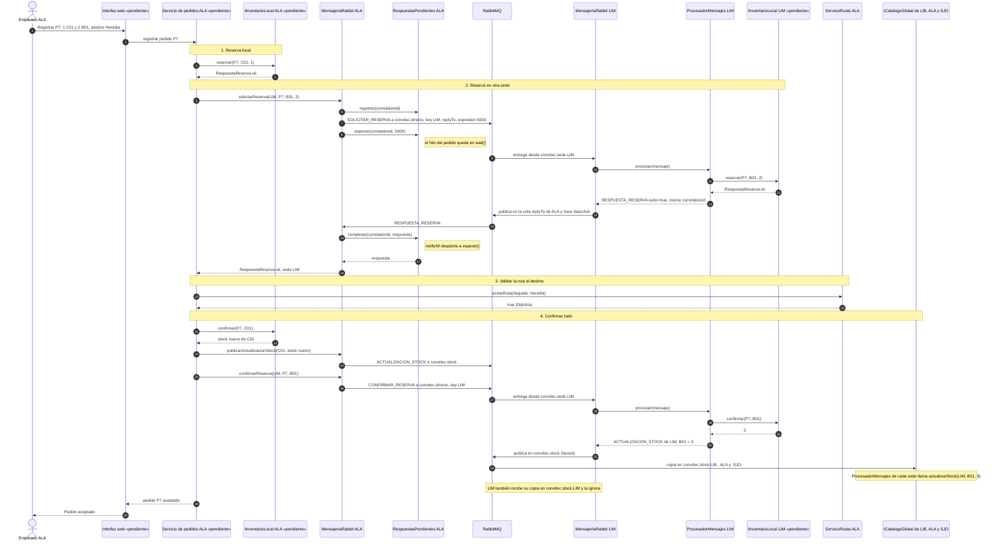
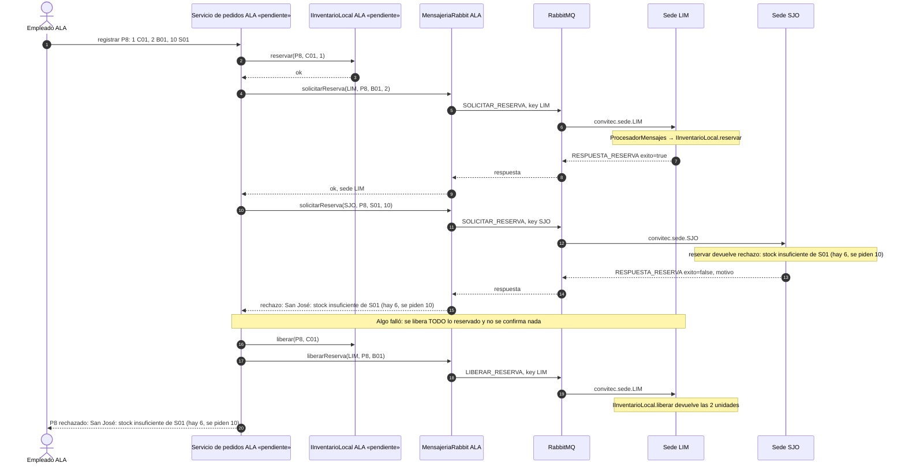
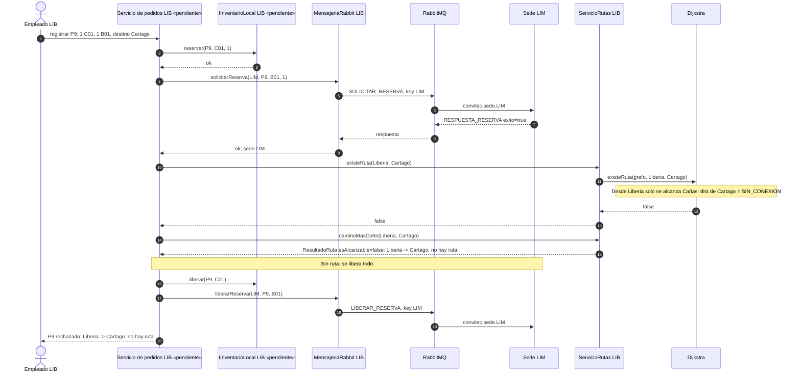
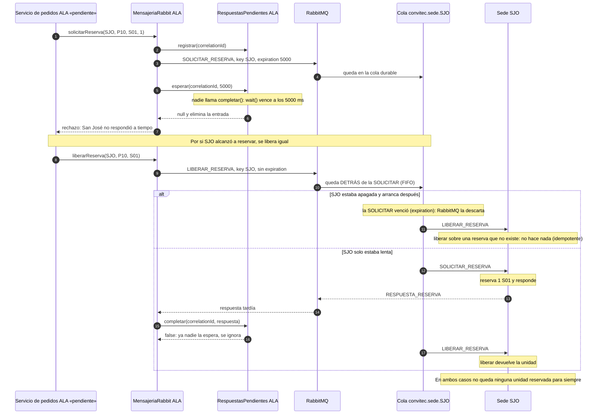
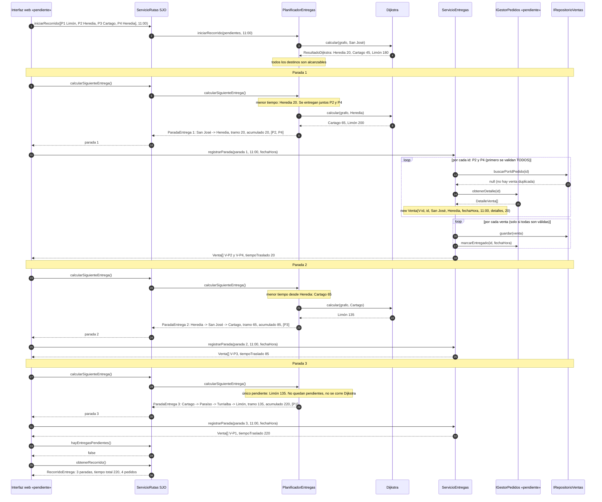

# Diagramas de secuencia

Parte del [DI3 — Diseño de la solución](DI3-diseno-solucion.md).

Convenciones:
- **«pendiente»**: participante de la Persona 1 o de la Persona 2 que todavía no existe. Se nombra por la interfaz que implementará (`IInventarioLocal`, `IGestorPedidos`...). El "servicio de pedidos" de la Persona 2 todavía no tiene nombre de clase.
- Los métodos, tipos de mensaje, exchanges y colas son los reales del código.
- Los productos y cantidades son los de las clases de demostración (`demo.InventarioDemo`). Por ejemplo, B01 "Bebida" solo existe en LIM.
- Ruta de los mensajes: `MensajeriaRabbit` publica en `convitec.directo` con routing key = código de la sede destino, y el mensaje llega a la cola `convitec.sede.COD`. Las respuestas van a la cola exclusiva indicada en `replyTo`, y las actualizaciones de stock a `convitec.stock` (fanout).

## a) Pedido exitoso con productos de 2 sedes

El empleado de **ALA** registra el pedido **P7**: 1 C01 (Café, hay en ALA) y 2 B01 (Bebida, solo hay en LIM), con destino **Heredia**.

## b) Pedido rechazado por falta de stock

El empleado de **ALA** registra **P8**: 1 C01 (ALA), 2 B01 (LIM) y 10 S01 (Sándwich, solo hay en SJO, con 6 unidades). Cuando SJO rechaza, ya hay unidades reservadas en ALA y en LIM, y hay que **liberarlas todas**.

No se publica ninguna `ACTUALIZACION_STOCK`, porque una reserva liberada no cambia el stock confirmado.

## c) Pedido rechazado por ruta

El empleado de **LIB** registra **P9**: 1 C01 (LIB) y 1 B01 (LIM), con destino **Cartago**. Las reservas salen bien (la mensajería no depende de las carreteras), pero Liberia y Cañas forman un componente aislado del grafo, así que no hay ruta a Cartago.

Un destino inalcanzable **no es un error**: `Dijkstra.caminoMasCorto` devuelve un `ResultadoRuta` con `esAlcanzable() = false` en lugar de lanzar una excepción. Solo se lanza `GrafoException` si la ubicación no existe.

## d) Una sede que no responde (timeout)

El empleado de **ALA** pide 1 S01 a **SJO**, pero la sede SJO está apagada o muy lenta. `reserva.timeoutMs` = 5000.

Por qué no hay inconsistencias:
1. La `SOLICITAR_RESERVA` y la `LIBERAR_RESERVA` van a la **misma cola** (`convitec.sede.SJO`), por el mismo exchange y desde el mismo canal de publicación. RabbitMQ mantiene el orden FIFO, así que el LIBERAR siempre llega **después** de la solicitud.
2. SJO consume su cola con **un solo consumidor** y `basicQos(1)`, y hace `basicAck` al terminar cada mensaje. Así procesa un mensaje a la vez, en orden.
3. La solicitud lleva **expiration = timeout**: si SJO no la procesó a tiempo, RabbitMQ la descarta y una solicitud vieja no aparta unidades horas después.
4. `IInventarioLocal.liberar` es **idempotente**: liberar una reserva que no existe no hace nada.
5. Una respuesta tardía no confunde a nadie: `RespuestasPendientes.completar` devuelve false y la respuesta se ignora.

Supuesto: hay **una sola instancia** por sede. Con dos consumidores sobre la misma cola, el orden de procesamiento no estaría garantizado.

## e) Salida de entregas paso a paso

Sede **San José**, salida de las 11:00, con los pendientes P1 → Limón, P2 → Heredia, P3 → Cartago y P4 → Heredia. Cada vez que la interfaz pide la siguiente entrega (botón "Calcular siguiente punto de entrega"), se registra esa parada como venta.

Detalles:
- Dijkstra se ejecuta **una vez por parada**: una vez desde la sede al iniciar y luego desde cada nueva ubicación mientras queden pendientes. Para 3 paradas se ejecuta 3 veces, no una vez por cada pedido.
- El vehículo **no regresa** a la sede: el tiempo total (220) termina en la última entrega.
- El `tiempoTraslado` de cada venta es el `getTiempoAcumulado()` de su parada: P2 y P4 = 20, P3 = 85, P1 = 220.
- El modo completo (`planificarRecorridoCompleto` y `ServicioEntregas.registrarRecorrido`) hace lo mismo en un ciclo, reutilizando estos métodos.
